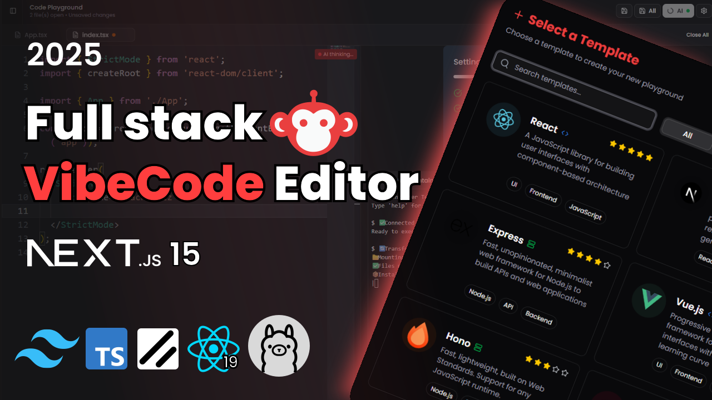

# 🧠 Vibecode Editor – AI-Powered Web IDE



**Vibecode Editor** is a blazing-fast, AI-integrated web IDE built entirely in the browser using **Next.js App Router**, **WebContainers**, **Monaco Editor**, and **LLMs via any OpenAI-compatible API** (Groq in production, Ollama locally). It offers real-time code execution, an AI-powered chat assistant, and support for multiple tech stacks — all wrapped in a stunning developer-first UI.

---

## 🚀 Features

- 🔐 **OAuth Login with NextAuth** – Supports Google & GitHub login.
- 🎨 **Modern UI** – Built with TailwindCSS & ShadCN UI.
- 🌗 **Dark/Light Mode** – Seamlessly toggle between themes.
- 🧱 **Project Templates** – Choose from React, Next.js, Express, Hono, Vue, or Angular.
- 🗂️ **Custom File Explorer** – Create, rename, delete, and manage files/folders easily.
- 🖊️ **Enhanced Monaco Editor** – Syntax highlighting, formatting, keybindings, and AI autocomplete.
- 💡 **AI Inline Suggestions** – Ghost-text code completion appears when you pause typing (or press `Alt + \`). Accept with `Tab`.
- ⚙️ **WebContainers Integration** – Instantly run frontend/backend apps right in the browser.
- 💻 **Terminal with xterm.js** – Fully interactive embedded terminal experience.
- 🤖 **AI Chat Assistant** – Share files with the AI and get help, refactors, or explanations.

---

## 🧱 Tech Stack

| Layer         | Technology                                   |
|---------------|----------------------------------------------|
| Framework     | Next.js 15 (App Router)                      |
| Styling       | TailwindCSS, ShadCN UI                       |
| Language      | TypeScript                                   |
| Auth          | NextAuth (Google + GitHub OAuth)             |
| Editor        | Monaco Editor                                |
| AI            | Groq (gpt-oss) in production, Ollama locally |
| Runtime       | WebContainers                                |
| Terminal      | xterm.js                                     |
| Database      | MongoDB (via DATABASE_URL)                   |

---

## 🛠️ Getting Started

### 1. Clone the Repo

```bash
git clone https://github.com/your-username/vibecode-editor.git
cd vibecode-editor
````

### 2. Install Dependencies

```bash
npm install
```

### 3. Set Up Environment Variables

Create a `.env` file from the template and fill in your credentials:

```bash
cp .env.example .env
```

### 4. Configure the AI

The AI features talk to any OpenAI-compatible API. Pick one:

- **Groq (free, recommended)** – create a key at [console.groq.com/keys](https://console.groq.com/keys) and set `AI_BASE_URL`, `AI_API_KEY`, `AI_MODEL`, `AI_COMPLETION_MODEL` and `AI_REASONING_EFFORT` as shown in `.env.example`.
- **Ollama (offline)** – leave the `AI_*` variables unset, install [Ollama](https://ollama.com/) and run `ollama run codellama` (or set `OLLAMA_MODEL` to another code model).

### 5. Run the Development Server

```bash
npm run dev
```

Visit `http://localhost:3000` in your browser.


---

## 🎯 Keyboard Shortcuts

* `Alt + \`: Ask for an AI suggestion now (they also appear when you pause typing)
* `Tab` / `Esc`: Accept / dismiss the AI suggestion
* `Ctrl/Cmd + S`: Save file · `Ctrl/Cmd + Shift + S`: Save all

---


---

## 📄 License

This project is licensed under the [MIT License](LICENSE).

---

## 🙏 Acknowledgements

* [Monaco Editor](https://microsoft.github.io/monaco-editor/)
* [Groq](https://groq.com/) and [Ollama](https://ollama.com/) – LLM inference
* [WebContainers](https://webcontainers.io/)
* [xterm.js](https://xtermjs.org/)
* [NextAuth.js](https://next-auth.js.org/)

```
